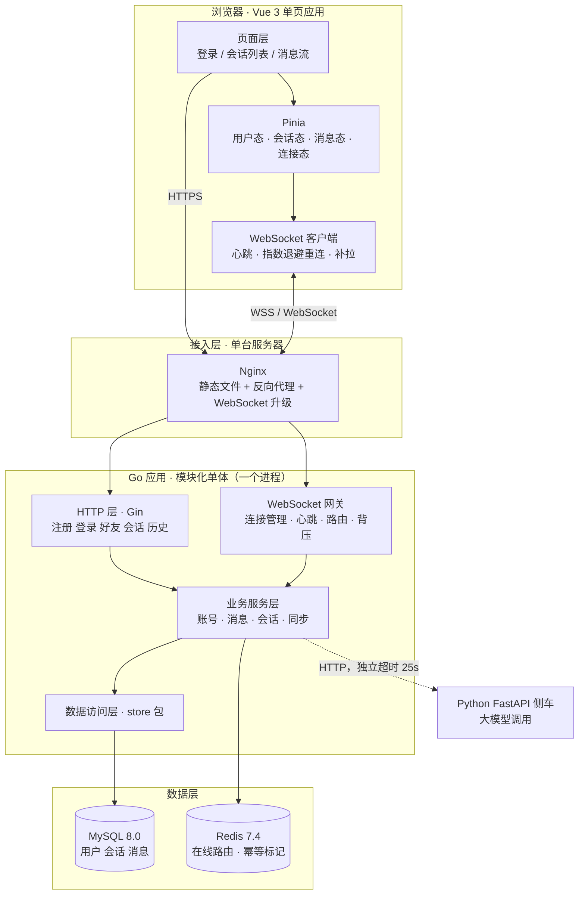
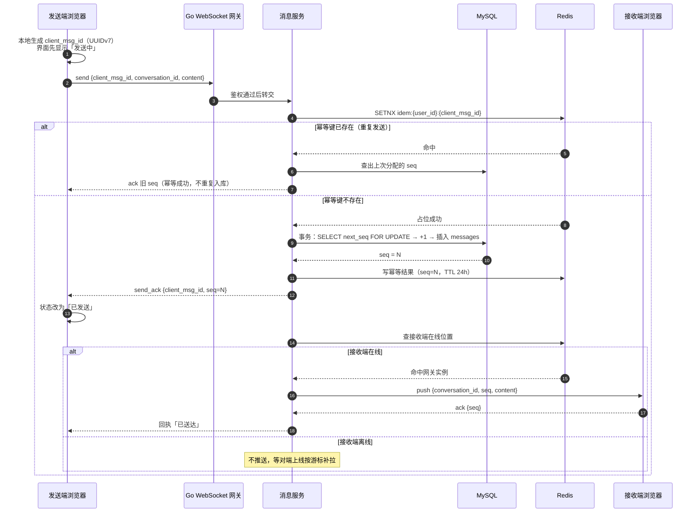
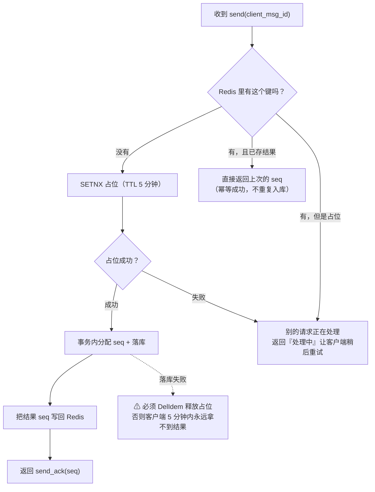
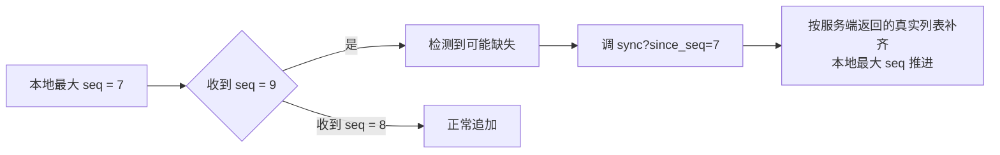
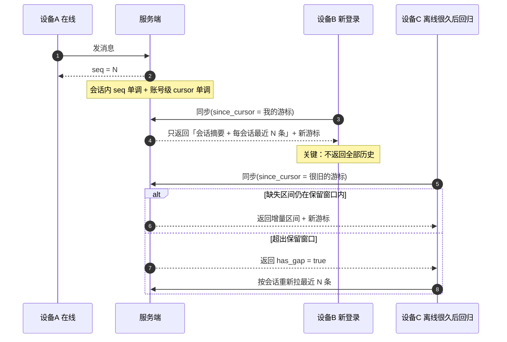
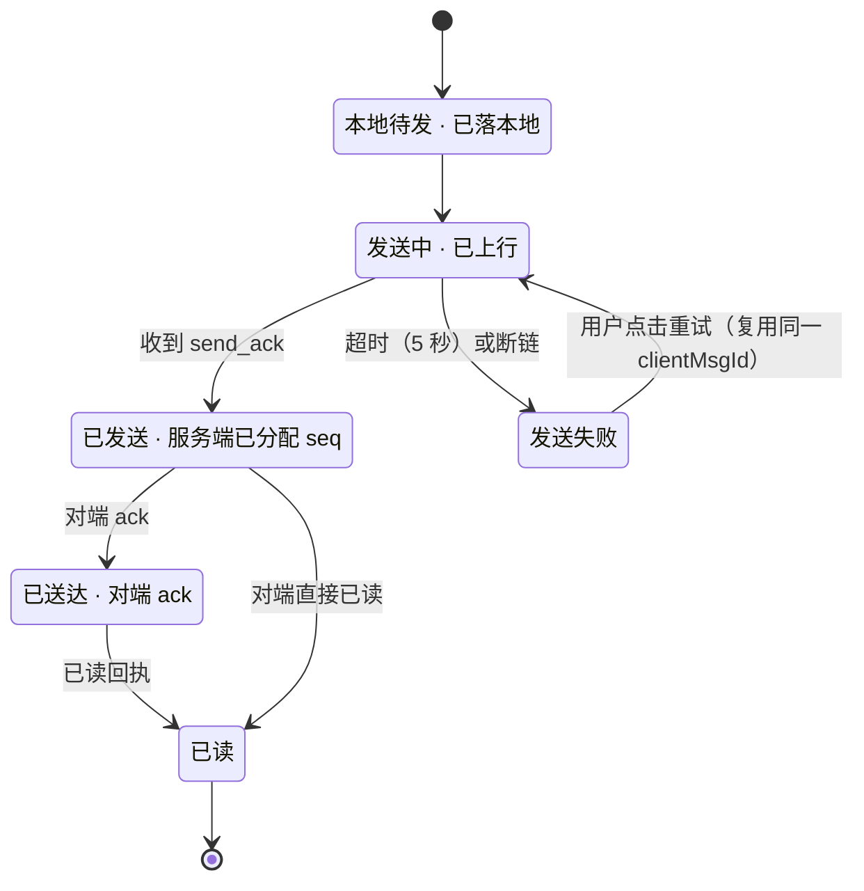
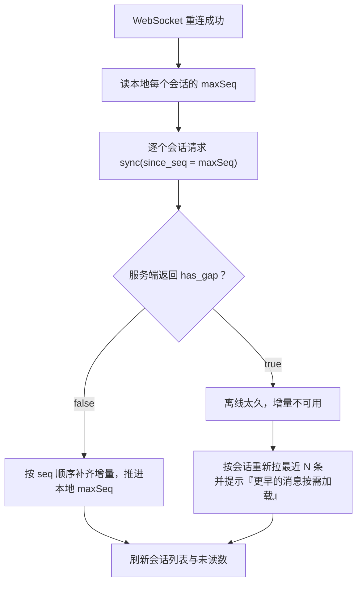
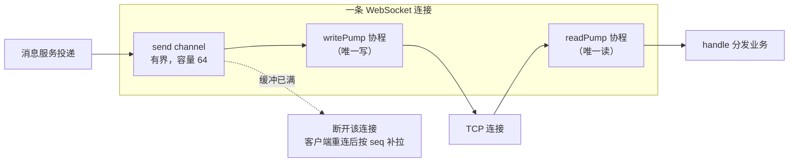

# 02 · 架构设计（ADR + 架构说明）

> **文档角色**：技术负责人
> **对应手册**：第 2 篇《设计》
> **前置**：[01-立项.md](01-立项.md)（项目章程与非目标已评审通过）
> **配套**：[er.md](er.md)（数据模型）· [api.md](api.md)（接口契约）

---

## 一、技术选型记录（ADR）

### ADR-001：后端选 Go

| 项 | 内容 |
| --- | --- |
| **决策** | 后端用 **Go 1.22+ + Gin** |
| **状态** | 已采纳 |

**理由（按权重排序）**

1. **反馈循环最短**：Go 编译是秒级的。本项目是零基础 + AI 辅助开发，**AI 的迭代轮数 × 每轮编译等待 = 总耗时**，这一项直接决定能否 14 周做完。
2. **长连接是 Go 的主场**：goroutine-per-connection 是最直接的表达方式；每条连接两个协程（读/写）的模型清晰可控。
3. **单二进制易部署**：交叉编译出一个静态文件，systemd 拉起即可，没有运行时依赖。
4. **可读性**：25 个关键字，没有注解 / Bean 生命周期 / AOP 这类隐性魔法，**我读得懂每一行，面试讲得出来**。

**放弃的方案与代价**

| 方案 | 为什么不选 |
| --- | --- |
| Java + Spring Boot | 学校招聘岗位数量最多，但构建与启动慢一个量级；Spring 的概念负担对零基础偏高，**最容易「能跑但讲不出来」** |
| Rust | 编译慢是 AI 迭代的头号成本（我前期调研过：55% 的 Rust 开发者增量重建 > 10 秒） |
| Python | 长连接不经济（GIL + 单进程模型），后端岗位覆盖也窄 |
| Node.js | 长连接要多进程 + 网关层，复杂度白送 |

**已知代价与对冲（诚实记录）**

> **Go 的学校招聘岗位漏斗比 Java 窄。** 目标档位里的「外包驻场」「传统行业数字化」「国企/银行科技」以 Java 为主。
>
> **四条对冲措施**：
> 1. **不删 Java**：简历与技能同时保留 Java（选课系统用过 Spring + Spring MVC + MyBatis，是真实经历）。
> 2. **投递画像表**：明确哪些公司/岗位适合投 Go 简历。
> 3. **Go ↔ Java 八股对照表**：并发、锁、GC、HTTP、TCP、MySQL、Redis 是通用知识，只是问法不同。
> 4. **切换预案**：若 2027 年 1 月发现 Go 岗位不足，用约 1 周基于同一套契约重写后端核心链路（前端不改）。

### ADR-002：模块化单体，不做微服务

| 项 | 内容 |
| --- | --- |
| **决策** | 单个 Go 进程，内部分层，**不拆服务** |
| **状态** | 已采纳 |

| 维度 | 微服务 | 模块化单体（本项目） |
| --- | --- | --- |
| 部署单元 | N 个进程 | **1 个二进制** |
| 本地调试 | 要起一堆容器 | **`go run` 就能跑** |
| 排查问题 | 要跨服务追踪 | **一个日志文件看全链路** |
| 事务一致性 | 分布式事务 / 最终一致 | **本地事务** |
| 时间成本 | 高 | **低** |

**拆分时机**：当某个模块出现**独立的扩缩容需求**时才拆（例如长连接网关需要独立扩缩，而账号服务不需要）。

**三条边界纪律**（面试会问）

1. **只有 `service` 层可以访问 `store` 层**；`handler` 和 `ws` 不许直接碰数据库。
2. **`store` 层只做数据存取，不含业务判断**（「能不能发消息」是 service 的事）。
3. **`handler` / `ws` 只做协议转换**，不写业务逻辑。

> **实际收益**：Sprint 4 做前端时只需看 `handler`/`ws` 的接口；Sprint 6 接 AI 只需加一个 service，不动数据层；**将来换语言只需重写 service + handler，表结构与接口契约都不动。**

### ADR-003：至少一次投递 + 幂等去重，不做「恰好一次」

| 项 | 内容 |
| --- | --- |
| **决策** | 投递语义为**至少一次**，重复由客户端 `client_msg_id` 与 `seq` 去掉 |
| **状态** | 已采纳 |

**理由**：追求「恰好一次」需要分布式事务或两阶段提交，在长连接场景下**代价极高且实际做不到**。「至少一次 + 幂等」在效果上等价，代价可控。

### ADR-004：写扩散（群消息）

| 项 | 内容 |
| --- | --- |
| **决策** | 群消息采用**写扩散**：消息落一条，然后给每个在线成员投递 |
| **状态** | 已采纳（小群场景） |

**理由**：本项目群规模小（演示场景 ≤ 几十人），写扩散**正确性最容易保证**（投递逻辑与单聊一致，只是收件人从 1 个变 N 个），读取也最快。

**可替换性**：扩散策略封装在 `service.Deliver` 一个方法里。将来遇到大群可替换为读扩散，**不需要改表结构和接口契约**。

### ADR-005：不用 Docker

| 项 | 内容 |
| --- | --- |
| **决策** | 部署用 systemd + Nginx，**不用容器** |
| **状态** | 已采纳 |

**理由**：① 只有一个二进制 + 一个静态目录要交付，容器解决的「多服务统一交付」问题不存在；② 本机无 WSL，装 Docker 要先装 WSL2 并占数 GB，而**开发机 D 盘仅剩 8.84 GB**；③ 少一层抽象 = 少一类问题，刚入门时能直接看到进程、日志、端口比多学一层容器网络更划算。

### ADR-006：AI 侧车用独立 Python 服务

| 项 | 内容 |
| --- | --- |
| **决策** | AI 能力用独立 FastAPI 服务，Go 通过 HTTP 调用 |
| **状态** | 已采纳（Sprint 6） |

**理由**：① Python 的大模型 SDK 生态最全；② **故障隔离**——大模型可能响应数秒甚至超时，如果塞进 Go 会占用主服务的 goroutine 与连接池；③ 换模型 / 加 RAG 只改 Python，**Go 侧只看到一个 HTTP 接口**。

---

## 二、总体架构



### 2.1 为什么 HTTP 和 WebSocket 两条路径

| 路径 | 承载什么 | 为什么 |
| --- | --- | --- |
| **HTTP** | 注册、登录、好友、会话列表、历史消息分页、增量补拉、健康检查 | 请求-响应语义清晰、可重试、可缓存、易调试 |
| **WebSocket** | 发消息、收推送、心跳、已读上报、在线状态 | 服务端主动推送，延迟降到网络往返级 |

> **补拉走 HTTP 不走 WebSocket**：补拉可能返回大量数据，HTTP 更适合，而且失败可以简单重试。

---

## 三、消息发送完整链路



> **这张图是面试的主战场。** 面试官会指着某一步问「这里为什么要这样」。**先把它画在纸上，反复讲到不用看图。**

---

## 四、四个核心设计决策

### 决策一：`client_msg_id` 幂等（解决「重复消息」）

**问题**：弱网下客户端会重发。「我发出去了但没收到 ack」→ 只能重发 → 服务端收到两条一样的。



**为什么用 UUIDv7 而不是 UUIDv4**

| | UUIDv4 | **UUIDv7** |
| --- | --- | --- |
| 结构 | 完全随机 | 前 48 位是**毫秒时间戳**，后 74 位随机 |
| 索引友好度 | 差（随机插入导致 B+ 树频繁页分裂） | **好**（时间有序，近似追加式插入） |
| 本项目 | — | **用它** |

**三层防护**（面试问「Redis 挂了怎么办」时答这个）

| 层 | 机制 | 作用 |
| --- | --- | --- |
| 1 | Redis `SETNX` | 快速拦截绝大多数重复（性能好） |
| 2 | MySQL `uk_sender_client` 唯一索引 | Redis 失效时的**兜底**：插入报 1062 就当幂等成功返回旧 seq |
| 3 | 客户端按 `seq` 去重 | UI 层最后一道，防止推送重复导致界面出现两条 |

### 决策二：会话内单调 `seq`（解决「乱序」与「缺失检测」）

| 关键点 | 说明 |
| --- | --- |
| **只能服务端分配** | 客户端和网关都不能生成。这是整个系统正确性的基石 |
| **事务内分配** | `SELECT next_seq FROM conversations WHERE id=? FOR UPDATE` → `+1` → 写回 → 插消息，四步在同一事务 |
| **给客户端的信息** | 客户端比较本地最大 seq 与收到的 seq，不连续就触发补拉 |
| **只保证会话内有序** | 不保证全局有序。全局有序没有业务价值，代价却极高 |



> ### ⚠️ `seq` 是「单调递增」，不是「连续」
>
> 如果某个事务回滚，它的 seq 会被跳过。**所以客户端不能用「连续性」判断消息缺失** —— 判据应该是「收到的 seq > 本地 max」，然后调 `sync` 拿服务端真实列表比对。
>
> **把「连续」当不变量是常见错误假设**，面试被问到要主动指出这一点。

### 决策三：账号级游标（解决「多端同步」）

**两个序列，职责不同**

| 序列 | 范围 | 解决什么 |
| --- | --- | --- |
| **会话内 `seq`** | 单个会话 | 单会话内**有没有乱序或缺失** |
| **账号级 `cursor`** | 跨会话 | 新设备登录时，**该从哪开始增量拉** |



> **经典性能陷阱**：新设备登录时「拉取全部历史」。正确做法是**只拉会话摘要 + 每会话最近 N 条**，更早的历史按需分页拉取。**这一条能避免登录时的雪崩。**

### 决策四：投递语义与消息状态机



> **`clientMsgId` 必须在「用户点发送」时生成一次，重试时复用。** 每次重试都生成新的，幂等就失效了 —— 这是最容易写错的地方。

---

## 五、心跳、重连与补拉

### 5.1 三个参数与理由

| 参数 | 取值 | 为什么是这个值 |
| --- | --- | --- |
| 客户端心跳间隔 | **25 秒** | 低于多数 NAT/代理的 30–60 秒空闲超时，能在被踢掉前先探活 |
| 服务端读超时 `pongWait` | **60 秒** | 给客户端留 2 次心跳的容错（丢一个包不会误判） |
| 服务端写超时 `writeWait` | **10 秒** | 写超时不能太长，否则慢客户端会占住 goroutine |

**约束**：`pingPeriod < pongWait`（25 < 60）。写反了连接会立刻超时断开。

### 5.2 重连退避算法

```text
第 1 次：等 1 秒
第 2 次：等 2 秒
第 3 次：等 4 秒
第 4 次：等 8 秒
第 n 次：min(2^(n-1), 30) 秒
每次叠加 ±20% 的随机抖动
```

| 设计点 | 为什么 |
| --- | --- |
| **指数退避** | 服务端挂了时，避免所有客户端同时猛敲（惊群） |
| **上限 30 秒** | 不能让用户等太久才能恢复 |
| **随机抖动 ±20%** | **关键**：退避时间完全一样的话，客户端会同时重连，反而制造第二次雪崩 |

### 5.3 断线重连后的补拉流程



---

## 六、背压与慢连接隔离



**两条铁律**

1. **一条连接必须有两个协程 —— 一个读、一个写。** `gorilla/websocket` **不允许并发写**，多个协程同时写会 panic。所有写必须经过唯一的 `writePump`。
2. **必须设超时和上限**，否则会被拖垮：读超时 60s、写超时 10s、消息上限 64KB、发送缓冲 64。

**为什么缓冲满时选择「断开」而不是「等待」或「丢弃」**

> 等待会阻塞投递方；丢弃会造成静默丢消息。**断开是最诚实的做法** —— 客户端重连后按 `seq` 游标补拉，消息不会丢，而且内存有硬上限。**无限缓冲只会把雪崩推迟到内存耗尽那一刻。**

---

## 七、可观测设计

**一个人运维，日志就是唯一的眼睛。**

### 7.1 结构化日志字段

```json
{
  "time": "2026-10-20T14:23:01.123+08:00",
  "level": "INFO",
  "msg": "message persisted",
  "trace_id": "01JABC...",
  "user_id": 1001,
  "conversation_id": 55,
  "client_msg_id": "01JAB...",
  "seq": 42,
  "latency_ms": 3
}
```

| 字段 | 为什么必须有 |
| --- | --- |
| `trace_id` | 跨越 HTTP → service → store 的关联 ID，排查时靠它串起一条链路 |
| `user_id` / `conversation_id` | 定位到具体用户和会话 |
| `client_msg_id` + `seq` | 消息相关问题的唯一线索 |
| `latency_ms` | 不记录耗时就无法发现性能退化 |

### 7.2 必须打日志的 6 个位置

| 位置 | 级别 | 为什么 |
| --- | --- | --- |
| 服务启动 / 退出 | INFO | 知道什么时候重启过 |
| 连接建立 / 关闭 | INFO | 排查「为什么他收不到消息」的第一手资料 |
| 幂等命中 | INFO | 能看出弱网重试的频次 |
| 心跳超时断开 | WARN | 网络问题的早期信号 |
| 数据库错误 | ERROR | 必须带完整错误与 SQL 上下文 |
| 慢查询（> 100ms） | WARN | 索引问题的早期信号 |

### 7.3 健康检查 `/healthz`

```json
{
  "status": "ok",
  "version": "0.4.0",
  "uptime_seconds": 86400,
  "checks": { "mysql": "ok", "redis": "ok", "ws_connections": 137 }
}
```

> `ws_connections` 这个数字很有用：部署后可以直接从浏览器看到当前连接数，**压测时不用另开工具就能观察承载量**。

### 7.4 不装 Prometheus / Grafana

**理由**：与 ADR-005 一致 —— 单机单服务规模下，**结构化日志 + `grep` + 一个 `/healthz` 覆盖了 90% 的排查场景**。引入 Prometheus + Grafana 会带来额外的部署与维护成本。指标采集设计成可插拔（`/healthz` 已输出关键指标），等有多实例需求时再接。

---

## 八、设计评审结论

| 评审项 | 结论 |
| --- | --- |
| 是否模块化单体且边界清晰 | ✅ 三层纪律 + 只有 service 能访问 store |
| 数据模型是否覆盖全部 Must 故事 | ✅ 6 张表，见 [er.md](er.md) |
| 接口契约是否完整 | ✅ 15 个 REST + 10 类 WebSocket 消息，见 [api.md](api.md) |
| 四个核心决策是否有明确结论 | ✅ 幂等 / 有序 / 同步 / 投递 |
| 参数是否有依据（不是拍脑袋） | ✅ 心跳 25s < 读超时 60s，退避带抖动 |
| 是否可观测 | ✅ 结构化日志 + 6 个必打位置 + /healthz |
| **是否允许进入开发阶段** | ✅ **通过** |
