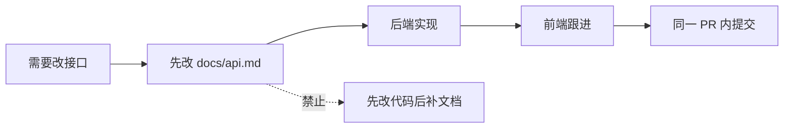

# 接口契约（REST + WebSocket）

> **对应手册**：第 2 篇 §2.3
> **状态**：**冻结**。前端与后端都按本文件实现；任何变更须先改本文件再改代码。
> **为什么先定契约**：① 前端可以在后端没写完时对着契约写 mock 并行开发；② 将来换语言（Java 切换预案）时**前端一行都不用改**。

---

## 一、通用约定

| 项 | 约定 |
| --- | --- |
| Base URL（开发） | `http://localhost:8080/api/v1` |
| Base URL（生产） | `https://<你的域名>/api/v1` |
| WebSocket（开发） | `ws://localhost:8080/ws?token=<access_token>` |
| WebSocket（生产） | `wss://<你的域名>/ws?token=<access_token>` |
| 鉴权 | `Authorization: Bearer <access_token>` |
| 请求体 / 响应体 | `application/json; charset=utf-8` |
| 时间字段 | **Unix 毫秒时间戳**（整数），前端负责格式化成「3 分钟前」 |
| 字段命名 | `camelCase`（Go 侧用 `serde`/`json` tag 转换，数据库用 `snake_case`） |

### 1.1 统一响应包装

```json
{
  "code": 0,
  "message": "ok",
  "data": { }
}
```

> **为什么包一层**：HTTP 状态码只能表达传输层语义，业务错误（如「用户名已存在」）需要自己的空间。**列表也包一层**（`items` / `total` / `nextCursor`），这样以后加分页字段不用改结构、客户端不用重写。

### 1.2 错误码

| code | 含义 | HTTP 状态 |
| --- | --- | --- |
| 0 | 成功 | 200 |
| 1001 | 参数错误 | 400 |
| 1002 | 未登录 / token 无效或过期 | 401 |
| 1003 | 无权限 | 403 |
| 2001 | 用户名已存在 | 409 |
| 2002 | 用户名或密码错误 | 401 |
| 2003 | 刷新令牌无效或已过期 | 401 |
| 3001 | 会话不存在 | 404 |
| 3002 | 不是该会话成员 | 403 |
| 4001 | 消息正在处理中，请稍后重试 | 409 |
| 5000 | 服务器内部错误 | 500 |

### 1.3 分页约定

| 场景 | 参数 | 说明 |
| --- | --- | --- |
| 会话列表 | `cursor` + `limit` | 游标分页。**不用 offset** —— 数据插入后会错位，深分页性能也差 |
| 历史消息 | `beforeSeq` + `limit` | **向前翻页**：聊天是「往上翻历史」，天然向前 |
| 增量补拉 | `sinceSeq` | 断线恢复专用，语义与翻页不同 |

---

## 二、REST 接口

### 2.1 接口清单（15 个）

| # | 方法 | 路径 | 鉴权 | 请求 | 响应 `data` |
| --- | --- | --- | --- | --- | --- |
| 1 | POST | `/auth/register` | ✗ | `{username, password, nickname}` | `{userId}` |
| 2 | POST | `/auth/login` | ✗ | `{username, password}` | `{accessToken, refreshToken, user}` |
| 3 | POST | `/auth/refresh` | ✗ | `{refreshToken}` | `{accessToken}` |
| 4 | POST | `/auth/logout` | ✓ | `{refreshToken}` | `{}` |
| 5 | GET | `/users/me` | ✓ | — | `{id, username, nickname, avatarUrl}` |
| 6 | GET | `/users?keyword=` | ✓ | query | `{items:[User], total}` |
| 7 | GET | `/friends` | ✓ | — | `{items:[User], total}` |
| 8 | POST | `/friends` | ✓ | `{friendId}` | `{}` |
| 9 | GET | `/conversations` | ✓ | `?cursor=&limit=` | `{items:[Conversation], total, nextCursor}` |
| 10 | POST | `/conversations` | ✓ | `{type, memberIds, title}` | `{conversationId}` |
| 11 | GET | `/conversations/:id/messages` | ✓ | `?beforeSeq=&limit=` | `{items:[Message], hasMore}` |
| 12 | GET | `/conversations/:id/sync` | ✓ | `?sinceSeq=` | `{items:[Message], latestSeq, hasGap}` |
| 13 | POST | `/conversations/:id/read` | ✓ | `{readSeq}` | `{}` |
| 14 | GET | `/conversations/:id/members` | ✓ | — | `{items:[Member]}` |
| 15 | GET | `/healthz` | ✗ | — | `{status, version, uptimeSeconds, checks}` |

### 2.2 数据结构

**User**

```json
{ "id": 1, "username": "test001", "nickname": "测试用户", "avatarUrl": "" }
```

**Conversation**

```json
{
  "id": 55,
  "type": 1,
  "title": "张伟",
  "lastMsg": "明天三点见",
  "lastMsgAt": 1791197597369,
  "latestSeq": 42,
  "myLastReadSeq": 40,
  "unreadCount": 2
}
```

**Message**

```json
{
  "id": 1001,
  "conversationId": 55,
  "seq": 42,
  "senderId": 1,
  "senderName": "张伟",
  "clientMsgId": "01JABC0000000000000000001",
  "contentType": 1,
  "content": "明天三点见",
  "createdAt": 1791197597369
}
```

### 2.3 关键接口详述

#### POST `/auth/register`

```json
// 请求
{ "username": "test001", "password": "Test1234", "nickname": "测试用户" }

// 成功
{ "code": 0, "message": "ok", "data": { "userId": 1 } }

// 用户名重复
{ "code": 2001, "message": "用户名已存在" }
```

**服务端校验规则**

| 字段 | 规则 | 失败错误码 |
| --- | --- | --- |
| `username` | 4–32 位，字母/数字/下划线，首字符为字母 | 1001 |
| `password` | **8–64 字符**（上限是 bcrypt 的 72 字节限制，主动收紧） | 1001 |
| `nickname` | 可空，最长 32 | 1001 |

#### POST `/auth/login`

```json
// 请求
{ "username": "test001", "password": "Test1234" }

// 成功
{
  "code": 0,
  "message": "ok",
  "data": {
    "accessToken":  "eyJhbGciOi...",
    "refreshToken": "kQ8vZ2...",
    "user": { "id": 1, "username": "test001", "nickname": "测试用户", "avatarUrl": "" }
  }
}
```

| 令牌 | 有效期 | 存放位置 | 说明 |
| --- | --- | --- | --- |
| `accessToken` | **30 分钟** | 客户端内存 | JWT，无状态。短有效期 = 泄露损失小 |
| `refreshToken` | **14 天** | 数据库存 SHA-256 哈希 | 用来换新 accessToken。**存哈希不存明文** |

#### GET `/conversations/:id/sync`

**这是断线恢复的核心接口。**

```json
// 请求： GET /conversations/55/sync?sinceSeq=40

// 成功
{
  "code": 0,
  "message": "ok",
  "data": {
    "items": [ /* seq > 40 的消息，按 seq 升序 */ ],
    "latestSeq": 42,
    "hasGap": false
  }
}
```

| 字段 | 语义 |
| --- | --- |
| `latestSeq` | 服务端当前最大 seq。客户端用它推进本地游标 |
| `hasGap` | **`true` 表示增量已不可用**（离线太久，或返回条数达到上限被截断）。客户端应改为「按会话重新拉最近 N 条」 |

#### POST `/conversations/:id/read`

```json
{ "readSeq": 42 }
```

**语义**：把 `conversation_members.last_read_seq` 推进到 `max(当前值, readSeq)` —— **只前进，不回退**。

---

## 三、WebSocket 协议

### 3.1 连接

```
ws://localhost:8080/ws?token=<accessToken>
```

> ⚠️ **为什么 token 走 query 而不是 Header**：WebSocket 握手**无法自定义请求头**，只能走 query 或子协议。
> **代价**：token 会出现在服务器访问日志里。**生产环境用 WSS，并依赖 accessToken 只有 30 分钟有效期来降低风险。**

握手失败时返回 HTTP `401` + 统一错误体（不会升级为 101）。

### 3.2 消息信封

所有 WebSocket 消息都是这个结构：

```json
{
  "type": "send",
  "reqId": "客户端生成的请求ID",
  "data": { }
}
```

> **`reqId` 的用处**：客户端发请求时带上，服务端在响应里回显。**弱网下同一条消息可能重发多次，靠它配对「这个响应是回给哪次请求的」。**

### 3.3 客户端 → 服务端

| type | data | 说明 |
| --- | --- | --- |
| `send` | `{clientMsgId, conversationId, contentType, content}` | 发消息 |
| `ack` | `{conversationId, seq}` | 确认收到推送 |
| `read` | `{conversationId, readSeq}` | 上报已读 |
| `ping` | `{}` | 心跳（每 25 秒） |

### 3.4 服务端 → 客户端

| type | data | 说明 |
| --- | --- | --- |
| `send_ack` | `{clientMsgId, seq, createdAt}` | 发送成功，服务端已分配 seq |
| `push` | `{conversationId, seq, senderId, senderName, contentType, content, createdAt}` | 收到新消息 |
| `read_push` | `{conversationId, userId, readSeq}` | 对方已读 |
| `presence` | `{userId, online}` | 在线状态变化 |
| `error` | `{code, message, reqId}` | 错误 |
| `pong` | `{}` | 心跳回应 |

### 3.5 完整示例

**发送一条消息**

```json
// C→S
{
  "type": "send",
  "reqId": "r-001",
  "data": {
    "clientMsgId": "01JABC0000000000000000001",
    "conversationId": 55,
    "contentType": 1,
    "content": "明天三点见"
  }
}
```

```json
// S→C（成功）
{
  "type": "send_ack",
  "data": {
    "clientMsgId": "01JABC0000000000000000001",
    "seq": 43,
    "createdAt": 1791197597369
  }
}
```

```json
// S→C（对端在线时，对端收到）
{
  "type": "push",
  "data": {
    "conversationId": 55,
    "seq": 43,
    "senderId": 1,
    "senderName": "邱漫",
    "contentType": 1,
    "content": "明天三点见",
    "createdAt": 1791197597369
  }
}
```

```json
// S→C（失败：正在处理中，客户端应稍后重试）
{
  "type": "error",
  "data": { "code": 4001, "message": "消息正在处理中，请稍后重试", "reqId": "r-001" }
}
```

### 3.6 `contentType` 预留扩展位

| 值 | 含义 |
| --- | --- |
| 1 | 文本（当前唯一实现） |
| 2 | 图片 |
| 3 | 文件 |
| 4 | 语音 |
| 5 | 系统消息 |

> **为什么留这个字段**：将来加图片消息时**只需在 service 层加一个分支**，表结构和接口契约都不用改。

---

## 四、客户端实现约定

### 4.1 消息去重（必须）

**服务端是「至少一次」投递**，客户端可能收到重复的 `push`。**必须按 `seq` 去重**：

```typescript
const seen = new Set(list.map(m => m.seq))
for (const m of incoming) {
  if (!seen.has(m.seq)) { list.push(m); seen.add(m.seq) }
}
list.sort((a, b) => a.seq - b.seq)
```

### 4.2 `clientMsgId` 的生命周期（容易写错）

| 时机 | 动作 |
| --- | --- |
| **用户点击发送时** | 生成一次 UUIDv7 |
| 乐观更新到界面 | 用这个 ID 标记「发送中」 |
| **超时重试时** | **复用同一个 ID**（⚠️ 重新生成会让幂等失效） |
| 收到 `send_ack` | 用 `clientMsgId` 找到本地那条，填上 `seq`，状态改「已发送」 |

### 4.3 重连后的动作

```text
onclose → 指数退避（1→2→4→8→16→30 秒，±20% 抖动）→ 重连
onopen  → 对每个会话调 GET /conversations/:id/sync?sinceSeq=本地maxSeq
        → hasGap=true 时改为重新拉最近 N 条
```

> **随机抖动是必须的**：服务端重启时所有客户端同时断开，退避时间一样的话它们会同时重连，**把刚起来的服务端再打挂**。

---

## 五、契约变更流程



**规矩**：**接口契约的任何变更，必须先改本文件。** 这样它才始终是唯一事实来源，也才能支撑「切换语言时前端不改」这个承诺。

---

## 六、验证清单

| # | 检查项 | 期望 | 完成 |
| --- | --- | --- | --- |
| 1 | 15 个 REST 接口都有明确请求/响应 | 见 §2.1 | ⬜ |
| 2 | 错误码覆盖所有失败分支 | 见 §1.2 | ⬜ |
| 3 | 分页统一用游标 | 无任何接口使用 `offset` | ⬜ |
| 4 | 6 类 WebSocket 下行消息都有示例 | 见 §3.4/§3.5 | ⬜ |
| 5 | `hasGap` 的语义写清了客户端该怎么反应 | 见 §2.3 | ⬜ |
| 6 | 客户端去重与 `clientMsgId` 复用规则写清了 | 见 §4.1/§4.2 | ⬜ |
| 7 | 时间字段统一为毫秒时间戳 | 无字符串时间 | ⬜ |
