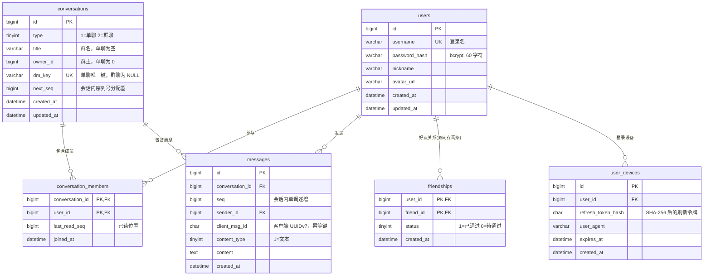

# 数据模型（ER + 表设计）

> **对应手册**：第 2 篇 §2.2
> **建表脚本**：[../server/migrations/001_init.sql](../server/migrations/001_init.sql)
> **状态**：已在本地 MySQL 8.0.45 执行通过

---

## 一、ER 图



---

## 二、六张表的职责

| 表 | 存什么 | 量级预期 | 特点 |
| --- | --- | --- | --- |
| `users` | 用户身份 | 小（演示级 < 1000） | 强关系、强一致 |
| `conversations` | 会话（单聊/群聊） | 小 | 承载 `next_seq` 分配器 |
| `conversation_members` | 谁在哪个会话 + 已读到哪 | 中 | 已读状态的载体 |
| `messages` | 消息本体 | **最大** | 写入热点，需要索引与分表预案 |
| `friendships` | 好友关系 | 小 | 双向存两条，查询简单 |
| `user_devices` | 登录设备与刷新令牌 | 小 | 支撑多端登录与登出 |

---

## 三、关键设计决策（每一行都可能被追问）

### 3.1 `conversations.next_seq` —— 序列号分配器

| 项 | 说明 |
| --- | --- |
| **为什么存在这张表上** | 序列号必须由**服务端集中分配**，客户端不能生成。放在会话行上，`SELECT ... FOR UPDATE` 时天然带行锁，不会分配重复 |
| **为什么不用全局自增 ID** | 全局 ID 当会话内 seq 会**产生空洞**，客户端无法判断「缺没缺」 |
| **代价** | 同一会话的消息发送被串行化。**这是有意的取舍**：会话内必须有序，而排序就需要集中分配 |

### 3.2 `messages` 的两个唯一索引

| 索引 | 字段 | 作用 |
| --- | --- | --- |
| `uk_conv_seq` | `(conversation_id, seq)` | **顺序唯一**：即使代码有 bug 也插不进重复 seq |
| `uk_sender_client` | `(sender_id, client_msg_id)` | **幂等兜底**：Redis 整个挂掉也不会产生重复消息 |

> ### ⚠️ 为什么没有单独建 `idx_conv_seq`
>
> 因为 `uk_conv_seq (conversation_id, seq)` **本身就是以 `(conversation_id, seq)` 为前缀的索引**，查询 `WHERE conversation_id = ? AND seq > ?` 完全用得上。
>
> **再建一个纯属冗余** —— 冗余索引会拖慢每一次写入，还白占空间。这是面试官会问的细节。

### 3.3 `conversations.dm_key` —— 单聊唯一性

**问题**：A 和 B 同时点「发消息」，两个请求同时建会话 → 出现两条单聊会话。

**方案**：`dm_key` 存 `"小id:大id"`，加唯一索引。

| 细节 | 说明 |
| --- | --- |
| **为什么要排序成「小id:大id」** | 直接用 `"a:b"` 的话，A 发起是 `"1:2"`、B 发起是 `"2:1"`，被当成两个不同的键，唯一索引拦不住 |
| **为什么群聊用 `NULL` 而不是 `''`** | **MySQL 的唯一索引允许多个 NULL**，所以群聊可以有很多条而单聊只有一条。用 `''` 的话**第二个群就插不进去了** |
| **实现模式** | 「先查、再插、撞索引再查」—— **把正确性交给数据库，而不是相信应用层的检查** |

### 3.4 `last_read_seq` 放在成员表，不在消息表

| 方案 | 问题 |
| --- | --- |
| `messages.is_read` 布尔字段 | **群聊里一条消息有 N 个已读状态**，一个布尔值根本表达不了 |
| 单独一张 `message_reads`（消息 × 人） | 10 人群 1000 条消息 = 10000 行，**写放大到无法接受** |
| **`conversation_members.last_read_seq`** | **每个成员只存一个数字**。1000 条消息在 10 人眼里只占 10 行 |

**语义**：`last_read_seq = 10` 表示「该成员已读到 seq 10，**包含** 10」。

**未读数计算**：

```sql
GREATEST(COALESCE(MAX(m.seq), 0) - cm.last_read_seq, 0) AS unread_count
```

> **为什么套 `GREATEST(..., 0)`**：如果 `last_read_seq` 因某种 bug 超过了最新 seq，相减会得到负数，界面会显示「-3 条未读」。**防御性写法比事后修 bug 便宜。**

**上报已读必须防止回退**：

```sql
UPDATE conversation_members
   SET last_read_seq = GREATEST(last_read_seq, ?)
 WHERE conversation_id = ? AND user_id = ?
```

> **为什么需要 `GREATEST`**：网络乱序时，一个「读到 5」的上报可能在「读到 10」之后到达。不加 `GREATEST` 就会把已读状态回退，界面上出现「已读又变回未读」的诡异现象。

### 3.5 时间精度与字符集

| 选择 | 理由 |
| --- | --- |
| `DATETIME(3)` 毫秒精度 | 同一秒内发的两条消息要能排序；且与前端 JS 的毫秒时间戳直接对齐 |
| `utf8mb4` / `utf8mb4_unicode_ci` | 默认 `utf8` **存不了 emoji**，而聊天里一定有 emoji |
| `BIGINT UNSIGNED` 主键 | 消息表会很大，`INT` 迟早不够 |

---

## 四、分表策略：现在不分，但留好路

**当前决策**：**不分表**。

**理由与预案（面试标准答法）**

> 「本项目数据量在百万级以内。我在 `conversations.next_seq` 上做了会话级递增，**所有查询天然总是带 `conversation_id`**，而 `messages` 的索引前缀就是它。
>
> 等单表超过千万行时，我可以按 `conversation_id` 哈希分成 16 张表 —— **因为所有查询都带这个字段，分表不需要跨表 join**。
>
> 我没有现在就分，因为分表会带来跨表聚合和扩容迁移的复杂度，而当前数据量不需要。」

**得分点**：知道分表方案、知道触发条件、**并且明确说了现在不做的理由**。

---

## 五、验证清单

在 Navicat 或命令行执行以下语句确认：

```sql
USE im_chat;

-- 1) 6 张表都在
SHOW TABLES;

-- 2) 索引是否符合设计（应看到 uk_conv_seq / uk_sender_client，且没有多余的 idx_conv_seq）
SHOW INDEX FROM messages;

-- 3) 字符集是否为 utf8mb4
SELECT TABLE_NAME, TABLE_COLLATION
  FROM information_schema.TABLES WHERE TABLE_SCHEMA = 'im_chat';

-- 4) 验证唯一索引真的生效（应当报 1062 错误）
INSERT INTO users (username, password_hash) VALUES ('idx_test', REPEAT('x', 60));
INSERT INTO users (username, password_hash) VALUES ('idx_test', REPEAT('x', 60));  -- 这里应报 1062
DELETE FROM users WHERE username = 'idx_test';

-- 5) 验证 dm_key 的 NULL 语义（群聊可以有很多条）
INSERT INTO conversations (type, title, dm_key) VALUES (2, '群A', NULL);
INSERT INTO conversations (type, title, dm_key) VALUES (2, '群B', NULL);  -- 不应报错
DELETE FROM conversations WHERE title IN ('群A', '群B');
```

| # | 检查项 | 期望 | 完成 |
| --- | --- | --- | --- |
| 1 | 6 张表 | `users` `conversations` `conversation_members` `messages` `friendships` `user_devices` | ⬜ |
| 2 | `messages` 索引 | 有 `uk_conv_seq`、`uk_sender_client`，**无**多余 `idx_conv_seq` | ⬜ |
| 3 | 字符集 | 全部 `utf8mb4_unicode_ci` | ⬜ |
| 4 | 用户名唯一索引生效 | 第二次插入报 `1062` | ⬜ |
| 5 | `dm_key` 允许多个 NULL | 插两条群聊不报错 | ⬜ |
